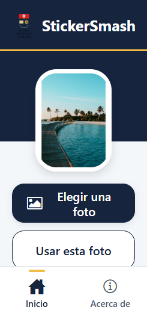

# StickerSmash

Aplicación para elegir una foto, agregar stickers y guardar la creación.

## Ejecución

```bash
npm install
npx expo start
```

Escanea el código QR con Expo Go para abrirla en tu celular.

## Captura


